# TimeGolf

Turn-based multiplayer mini-golf where the past is shared and can be rewritten. Re-do one of your old shots and every shot after it plays out again.

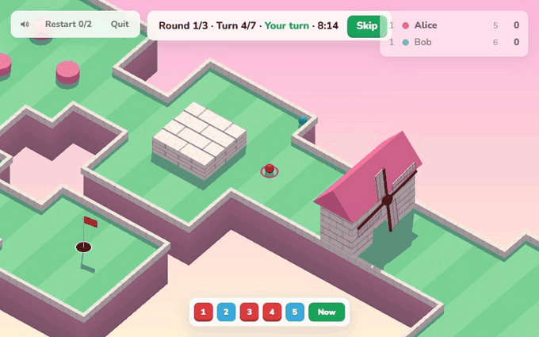

## What it is

Every hit by every player goes onto one shared timeline for the round. On your turn you can hit from where your ball is now, or go back and **re-do one of your own past hits**. The server then simulates the whole future again: every later hit (yours and your rivals') fires again with the same direction and power, starting from wherever the balls are now. One changed shot can push a rival off course, block a windmill gap, or knock a holed ball back out of the cup.

It runs in the browser with no install or account. Pick a name, join a lobby and press Ready.

## How to play

Join or create a lobby, press Ready. 3 rounds, 10 turns each, 60 s per turn.

On your turn: **hit**, **re-do one of your past hits** (pick it on the timeline), or skip. A re-do replays everything after it with the original shots — yours and everyone else's.

|           | Round score                                     |
| --------- | ----------------------------------------------- |
| Holed     | `ceil(100 / hits)`                              |
| Not holed | `ceil(100 / (hits + walking distance to hole))` |

Most points after 3 rounds wins. Holed players sit out until a re-do knocks them back out.

## Controls

| Input                          | Action                                     |
| ------------------------------ | ------------------------------------------ |
| LMB drag from own ball         | aim and shoot (or re-do the viewed hit)    |
| Esc / RMB while aiming         | cancel the aim                             |
| Click a timeline marker, ← / → | view a past moment                         |
| Esc / `Now`                    | back to the present                        |
| S                              | skip turn                                  |
| Wheel                          | zoom                                       |
| RMB drag                       | pan                                        |
| F                              | refocus on the ball                        |
| Q / E, MMB drag                | rotate camera (eased quarter turns / free) |
| M                              | mute                                       |

## Screenshots

|                                                                                                                                       |                                                                                                                                       |
| ------------------------------------------------------------------------------------------------------------------------------------- | ------------------------------------------------------------------------------------------------------------------------------------- |
| 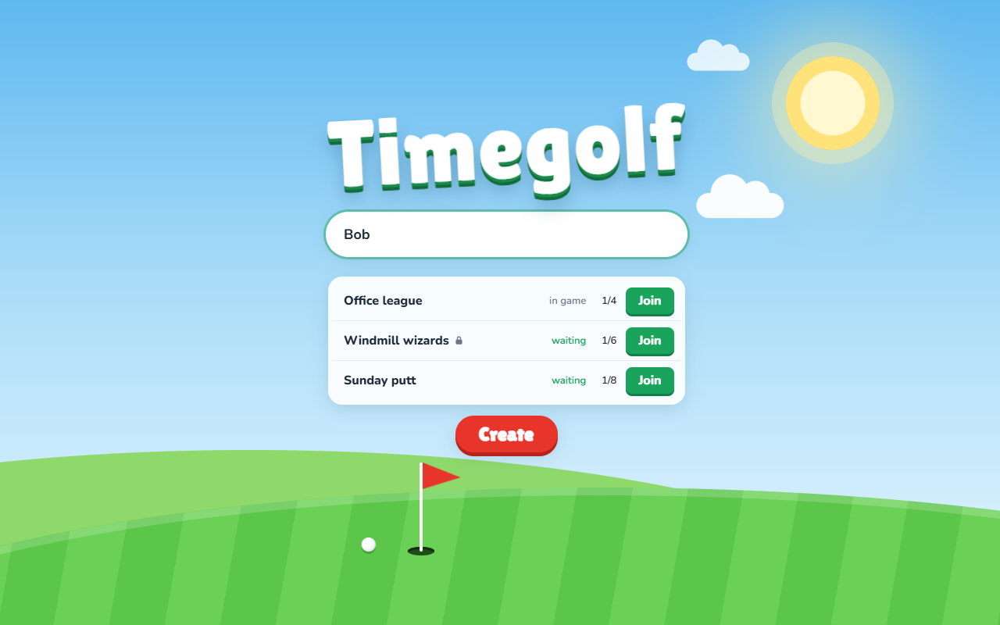                                                                            | 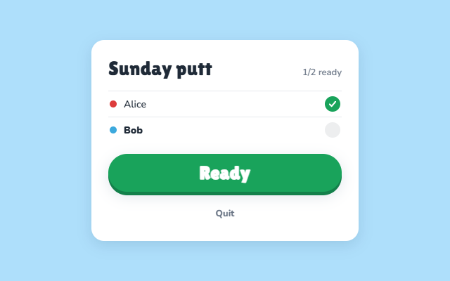                                                                                              |
| Main menu with the live lobby list                                                                                                    | Ready room                                                                                                                            |
| 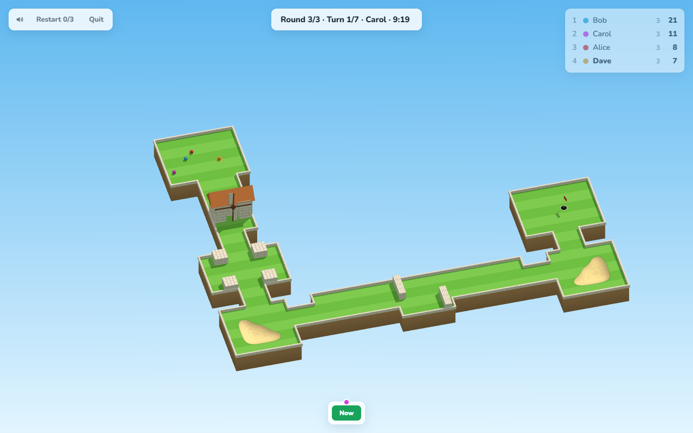                                | 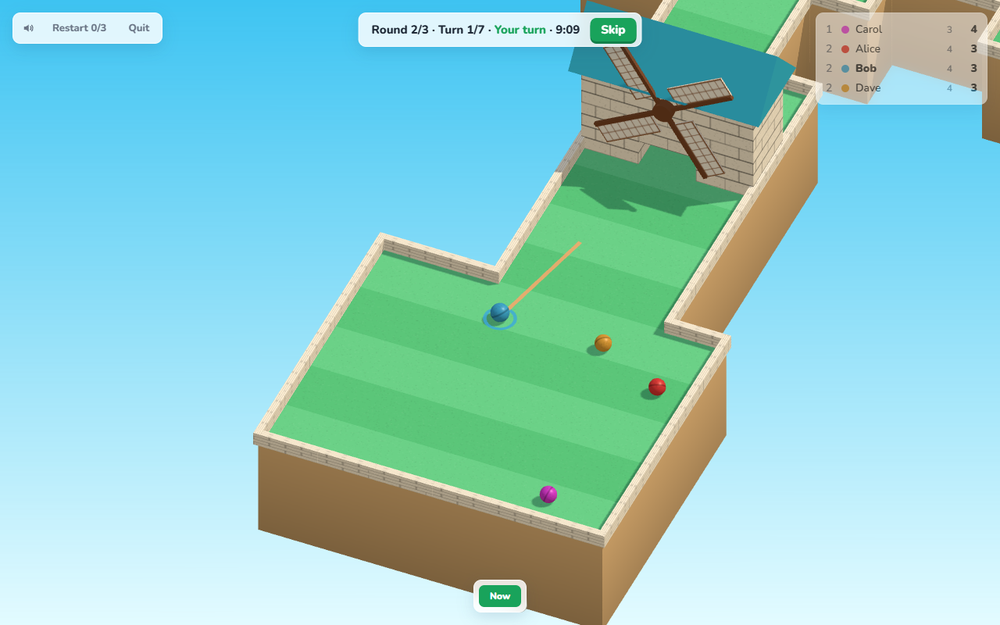                                            |
| Overview (Meadow): windmill, pillars, bunkers, hole                                                                                   | Aiming at the windmill, four players at the tee (Beach)                                                                               |
| 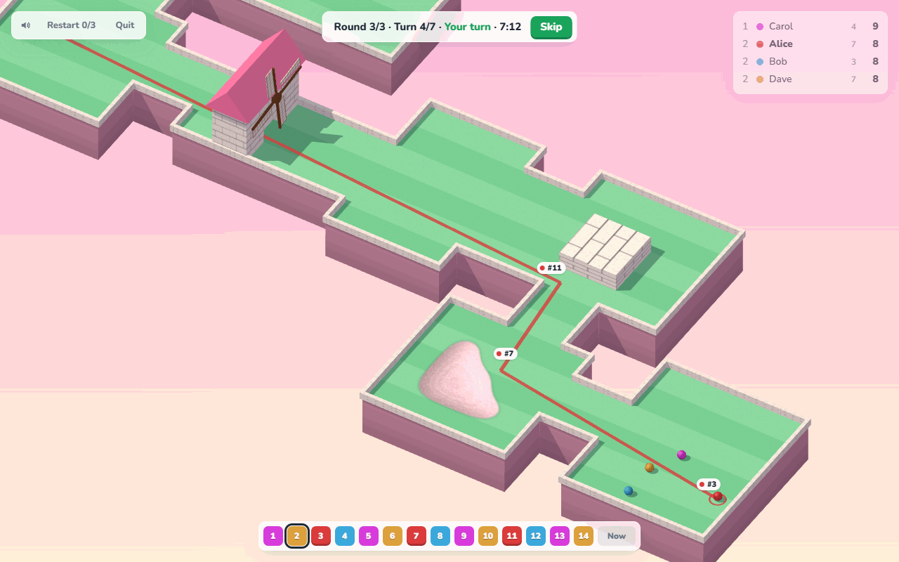 | 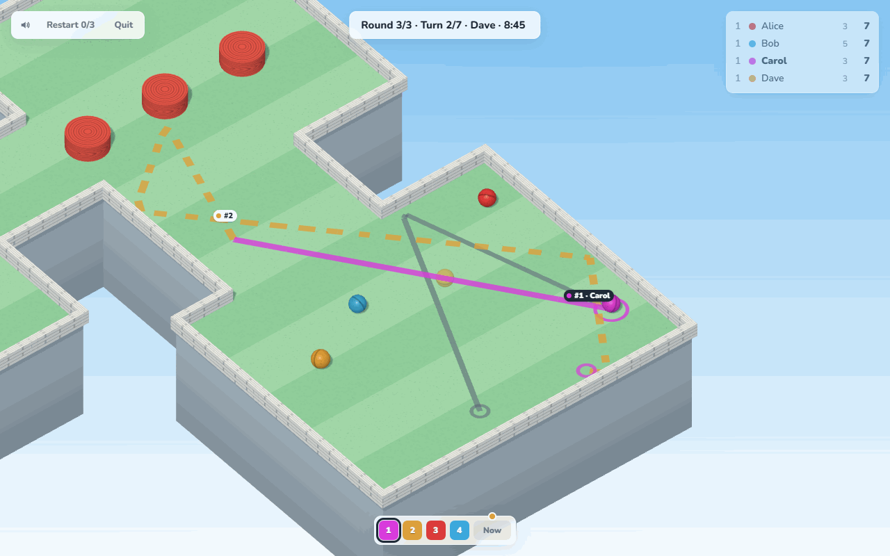 |
| Viewing a past hit: future path with `#n` badges (Candy)                                                                              | Changed future after Carol's re-do: ghost path and `#1 · Carol` badge (Snow)                                                          |
| 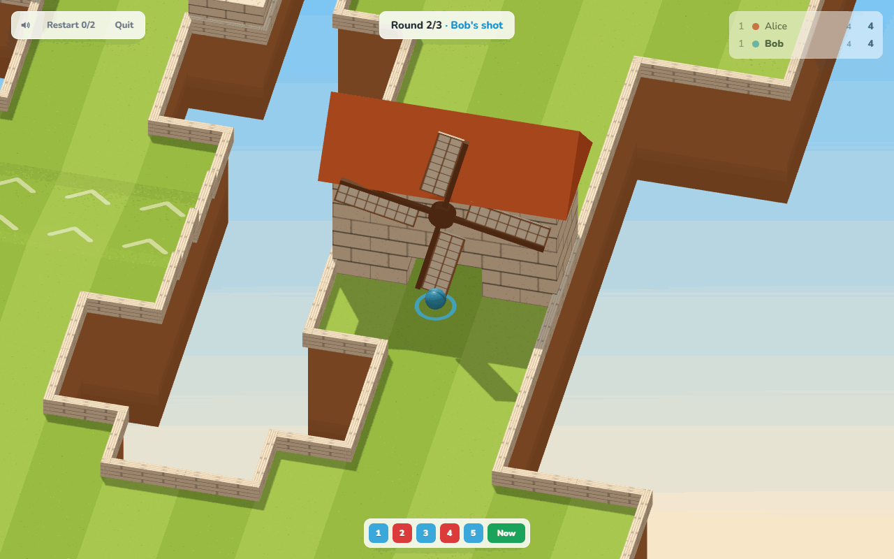                                             | 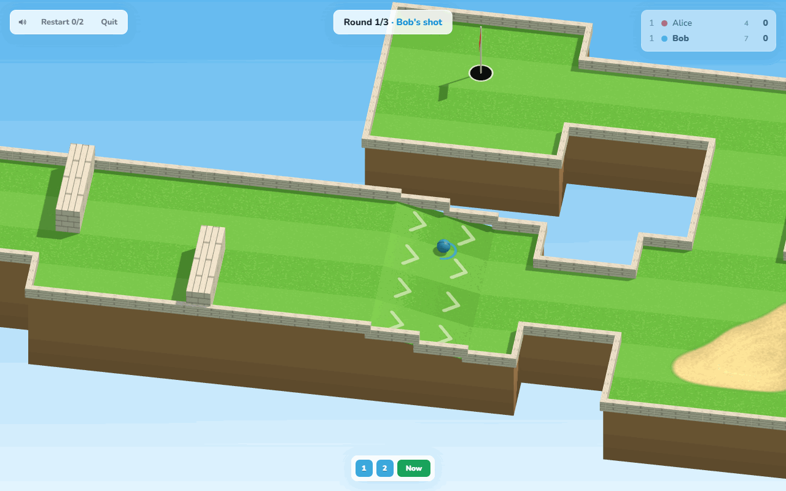                                              |
| Windmill close-up: the gap closes whenever a sail points down (Autumn)                                                                | Ramp down to a lower tier (Meadow)                                                                                                    |
| 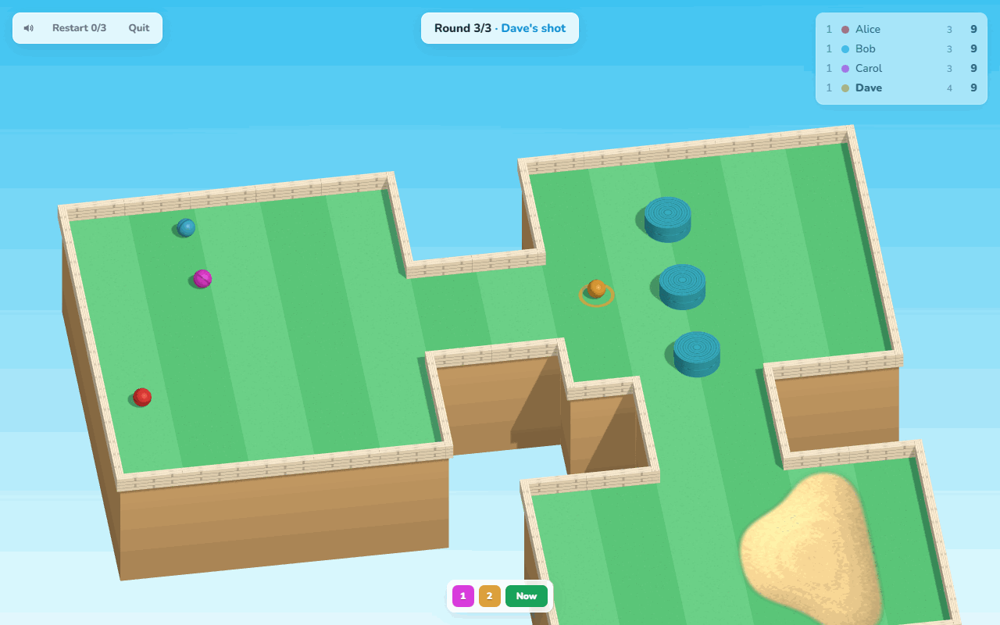                                                                  | 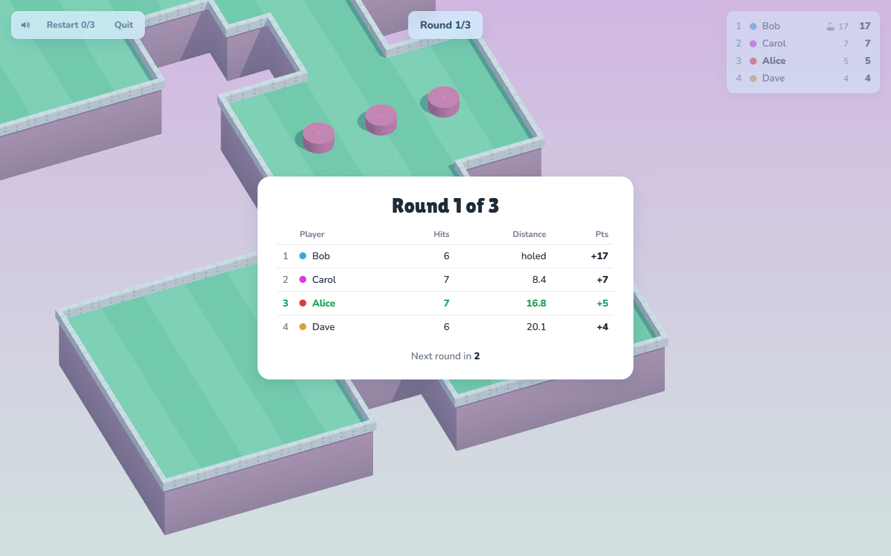                                                                       |
| Mid-shot into the bumpers (Beach)                                                                                                     | Round results                                                                                                                         |

**A shot through the windmill, bouncing off the plaza wall**

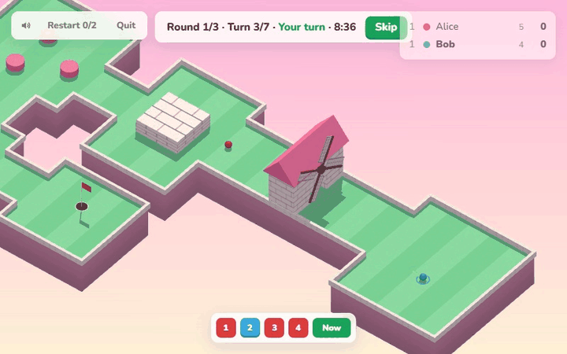

**Watching another player's live aim, including from a past moment**

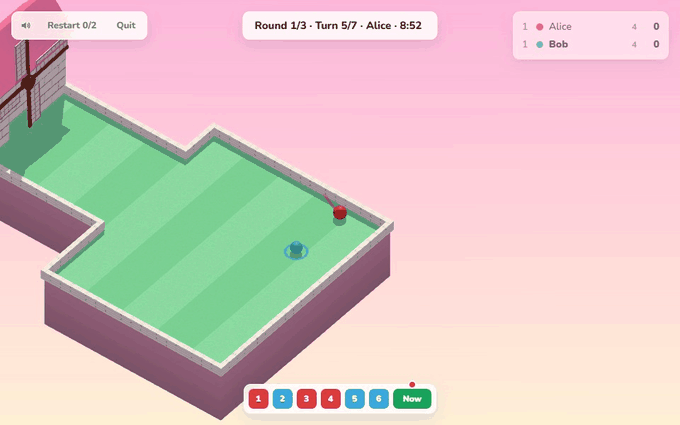

## Tech

- **Server**: .NET 10, ASP.NET Core SignalR, everything in memory with no database. The server owns the physics, which is deterministic: fixed 1/120 s steps, a seeded level and the same hit records always give the same result. That makes rewinding exact. Each hit is simulated instantly, and clients receive 20 Hz tracks and bounce events to play back. Lobbies run independently and are stepped in parallel.
- **Client**: React 19 + TypeScript, zustand, plain three.js, bundled with Rsbuild. A 2.5D look from an orthographic camera, a sun light with fitted shadows, and canvas-painted textures. The client uses no model or texture files: terrain tiers, ramps, walls, bumpers, windmills and the hole are all built in code.
- **Level generator**: a seeded random walk over a 7×5 grid of 6×6-cell modules. Each module gets one hand-tuned piece (open, corridor, chicane, plaza, bridge, bunker, ramp, bumpers, windmill), and difficulty rises each round. Every level is checked for beatability with a BFS that tests whether a ball fits through. If a level fails, obstacles are removed until it passes or it is regenerated. A Dijkstra distance field measures the walking distance used in scoring.

## Run locally

**Docker**

```
docker compose up --build
```

Open http://localhost:8080. To use a different port, set `PORT` in `.env` (see `.env.example`).

**Development**

```
dotnet run --project server/TimeGolf        # http://localhost:5000
cd client && npm install && npm run dev     # http://localhost:3000 (proxies /hubs and /health to :5000)
dotnet test TimeGolf.slnx
```

Open a second browser profile or an incognito window to play against yourself.

## Deployment

The app is deployed as a single Compose app with no external networks or proxy labels. On Dokploy, create a Compose app from this repo and attach your domain to service `frontend`, port 80. nginx serves the client and proxies `/hubs/` (WebSocket) and `/health` to the backend.

## Repo layout

```
server/TimeGolf/          .NET 10 server: hub, game loop, matches, lobbies
  Game/Simulation/        timeline, checkpoints, deterministic physics
  Game/Levels/            level model, generator, beatability validator
server/TimeGolf.Tests/    NUnit tests
client/                   Rsbuild + React app, Dockerfile, nginx.conf
  src/render/             three.js scene, camera, terrain, windmill, paths
  src/ui/                 menu, ready room, HUD, timeline, results
docs/PRD.md               full spec
docs/media/               README screenshots and GIFs
docker-compose.yml        backend + frontend
```

The full rules, protocol and architecture are in [docs/PRD.md](docs/PRD.md).
